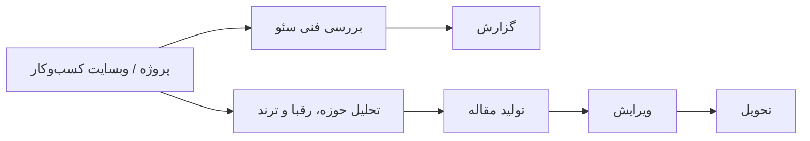

# Ranka: ایجنت هوش مصنوعی برای سئوی کسب‌وکارها (Case Study)

> **پروژه‌ی خصوصی برای کارفرما.** کد منبعش عمومی نیست؛ این صفحه فقط توضیح می‌دهد پروژه چیست، من چه کاری توش کردم و چرا بعضی تصمیم‌های فنی را این‌طوری گرفتم.

## معرفی

Ranka یک ایجنت هوش مصنوعی است که به کسب‌وکارها کمک می‌کند در گوگل بهتر دیده شوند. اول وبسایت را از نظر فنی برای سئو بررسی می‌کند و نتیجه را در یک گزارش به صاحب کسب‌وکار می‌دهد. بعد برای همان وبسایت مقاله‌ی سئوشده می‌نویسد و ویرایشش می‌کند، آن هم با توجه به حوزه‌ی فعالیت، رقبا و ترندهای روز اینترنت.

## نقش من

ایجنت را از صفر طراحی کردم و ساختم. بخش تولید محتوا را هم خودم نوشتم و مرحله‌های مختلف را به هم وصل کردم تا یک جریان کاری یکپارچه بشود.

## قابلیت‌های اصلی

* **بررسی فنی سئو:** وبسایت کسب‌وکار را چک می‌کند و مشکلاتش را گزارش می‌دهد
* **تحلیل رقبا و ترند:** می‌بیند کسب‌وکار در چه حوزه‌ای است، رقبایش کی‌ها هستند و اینترنت این روزها دنبال چه چیزی است
* **تولید مقاله‌ی سئوشده:** بر اساس نتیجه‌ی تحلیل برای وبسایت مقاله می‌نویسد
* **ویرایش:** قبل از تحویل، مقاله را دوباره می‌خواند و اصلاح می‌کند
* **گزارش:** نتیجه‌ی کار را به صاحب کسب‌وکار تحویل می‌دهد

## معماری

## تکنولوژی‌ها

* **زبان:** Python
* **ایجنت و LLM:** LangChain
* **اتوماسیون:** n8n
* **هوش مصنوعی:** تولید و ویرایش محتوا با LLM

## چالش‌های فنی

* **جلوگیری از مقاله‌های کلی و شبیه هم.** اگر محتوای سئو فقط از یک پرامپت ساده ساخته شود، برای همه‌ی کسب‌وکارها یک شکل درمی‌آید. برای همین هر مقاله را بر اساس حوزه، رقبا و ترند همان کسب‌وکار می‌ساختم.
* **زنجیره کردن چند مرحله پشت سر هم.** بررسی فنی، تحلیل، نوشتن و ویرایش هرکدام مرحله‌ی جدایی بودند و باید خروجی هرکدام درست به مرحله‌ی بعد می‌رسید.
* **قابل‌اعتماد کردن گزارش‌ها.** گزارش سئو باید دقیق باشد و بشود رویش کار کرد، نه اینکه فقط یک متن کلی و عمومی باشد.

## ملاحظات امنیتی

چون ایجنت با وبسایت و داده‌ی کسب‌وکارها کار می‌کند، این موارد برایم مهم بود:

* نگه‌داری امن کلیدهای API و اطلاعات هر پروژه
* جدا بودن داده‌ی هر کسب‌وکار از بقیه
* پاک‌سازی محتوای صفحه‌هایی که ایجنت می‌خواند، قبل از دادنشان به مدل (خطر Prompt Injection)
* رعایت محدودیت نرخ در درخواست‌ها به سایت‌ها

## چی یاد گرفتم

* چطور چند مرحله‌ی هوش مصنوعی را به یک جریان کاری قابل‌اعتماد تبدیل کنم
* اینکه خروجی LLM را همیشه باید با یک مرحله‌ی بازبینی کنترل کرد
* اینکه ایجنتی که از اینترنت ورودی می‌گیرد سطح حمله‌ی تازه‌ای دارد و باید از همان اول به امنیتش فکر کرد

